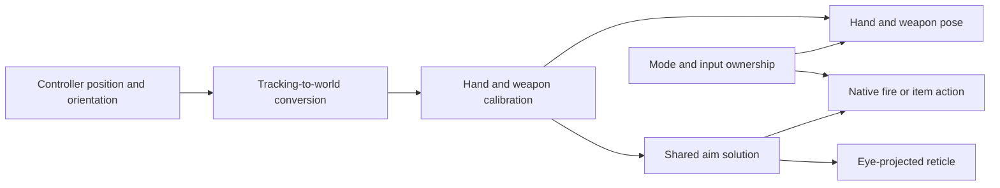

# Loose hands and tracked weapons

Status: design/backlog only, October 21, 2026. No runtime, input, profile, or
backend changes are part of this planning work.

## Goal and first playable slice

Make both hands follow controller position and full orientation, including
forward/back movement and wrist roll. Keep the game's hand poses and animations
where practical. A held weapon should feel attached to the hand, with its aim,
firing effects, impacts, and reticle agreeing at different ranges.

The first playable slice is **both tracked hands and one simple one-handed gun**,
with a live on/off switch that restores the accepted profile. Additional weapon
families, physical mining/melee, and throwing follow separately. Emote and spell
gestures are later work. A visual pose preview can precede the playable slice,
but moving a mesh alone does not establish correct firing behavior.

## What we have and what we must discover

The existing controller helper steers native control rotation from right-hand
yaw/pitch. It compensates camera yaw so aiming does not turn the headset view.
The reticle traces the pre-stereo firing camera and projects its target into the
rendered eye. Controller translation and wrist roll do not yet drive a held rig.

Before implementation, identify the current player's hand/weapon mesh hierarchy,
bones/sockets, animation ownership, equipped-item lifetime, muzzle, native shot
origin, projectile/hit callbacks, and the relevant item actions. Determine whether
hands are separate components or part of a shared animated skeleton. Component
attachment, bone overrides/IK, or a small native hook are alternatives; choose
after this inspection, rather than assuming an attach operation will suffice.

Use a focused read-only capture of the equipped player and representative item
families when implementation begins. Record class paths and relationships rather
than session-specific addresses. Reuse [the native constraints](DEVELOPMENT.md#native-access-constraints).
Existing SDK world lookups and some UObjectHook discovery paths remain unsuitable
for this game/backend. A backend change is an option if proven necessary, using
the retained isolated source checkout.

## Reversible mode and ownership

Proposed behavior, to implement later:

- Default off. A live `hands.enabled` setting and an experimental UEVR-panel
  checkbox control the same mode. Exact setting schema and UI are still design
  decisions; no configuration key or button binding is installed now.
- Off runs the current aiming/control path. On gives the hands coordinator
  explicit ownership of pose, aim, and any remapped actions; two aiming writers
  must never compete. Menus retain the accepted controller pointer behavior.
- Disabling restores owned attachments, visibility, pose/animation overrides,
  calibration effects, and input routing without restarting the game. Clear
  animation overrides so current native animation resumes; do not restore an
  old animated frame over fresh game state.
- Pause, loading, cinematics, death, possession changes, and tracking loss suspend
  experimental writes and return to the appropriate baseline presentation. Resolve
  the current pawn/equipped item afresh and validate cached component identities.
- Release only synthetic inputs owned by the experiment. Switching modes or
  recovering tracking while a trigger/grip is held must not fire, throw, or cast;
  require a fresh release/press before accepting that action again.
- Unsupported items retain baseline behavior with a clear experimental status.
  Save calibration separately from the working profile's global settings.

A live toggle is an acceptance requirement, not just a startup flag. The ability
to undo runtime input interception must be demonstrated before grip remapping.

## Pose, calibration, and aiming model

Use the game's actual tracking origin, recenter/snap-turn anchor, and UEVR world
scale. The current scale is 0.010000; measure physical travel against headset
travel before choosing a conversion. Do not change viewing scale to compensate
for a controller-space error. Establish the distinction between controller grip
pose, controller aim pose, and the weapon's grip/muzzle axes. Our custom pose
bridge was prepared for aiming; verify the pose it returns before reusing it for
hand attachment, and expose separate poses if calibration alone is insufficient.

Each item family needs a grip transform, muzzle/forward reference, hand pose, and
any secondary grip points. Schematically:
`weapon_world = tracking_to_world * controller_grip * grip_to_weapon`.
Retain animation of triggers, reloads, and other moving parts where feasible.
Add smoothing only after measuring jitter, keeping pose/aim timing consistent.

For the first gun, determine whether native firing uses the camera, a muzzle
socket, a projectile spawn transform, or a combination. The displayed gun,
shot origin/direction, reticle, and collision behavior must share a consistent
solution. Test forward/back movement and near-wall obstruction, not just wrist
rotation. Reuse the accepted eye projection/shape correction. Keep visual render
updates separate from gameplay hit updates so a per-eye callback cannot apply
an attack twice. Verify the engine thread/update point before writing transforms.

Local hand rendering does not prove multiplayer replication. Preserve native
ammo, cooldowns, damage, and action requests. Later verify both hosting and joining
before claiming that other players see poses or that translated muzzle firing
works correctly in co-op.

## Input design before remapping

Current grips cast left/right spells; both grips cast the third spell. They are
not spare buttons. Keep these controls through pose/calibration work. Before
adding grab/release, compare two schemes: retain button-held weapons and spell
grips, or introduce contextual grabbing with an explicit alternative for all
three spells. Choose the scheme together after a prototype demonstrates the need.

Make an action table covering fire/alt-fire, reload, equip/swap, interaction,
spells, tool use, throw, pause, and shifted D-pad actions. Check ordering across
UEVR, RemapControls, JoyToKey, and Lua: an already-emitted synthetic key cannot
necessarily be suppressed by a later callback. If a plugin mapping requires a
restart, it cannot provide the promised live toggle without an additional runtime
gate. Keep X/interact, B/pause, menu pointing, movement, snap turns, horse Down,
map Right, and the other native D-pad actions usable. Input hints must follow the
selected scheme when remapping is eventually introduced.

## Staged backlog and acceptance gates

Order is provisional; inspect dependencies before committing to estimates.

| Stage | Work | Acceptance gate |
| --- | --- | --- |
| LH-0 | Focused rig/item/action survey; settle pose and firing model | Identify both hands, one gun, its native firing path and animation owner; choose a verified access route. |
| LH-1 | Live toggle, ownership, calibration, and pose preview | Repeated on/off and tracking/menu transitions restore the current baseline; no remapping required. |
| LH-2 | Both hands plus one playable one-handed gun | Translation and wrist roll follow controllers; muzzle, impacts, and reticle agree near/far and near walls; disabling restores baseline aiming. |
| LH-3 | Data-driven item profiles and input scheme | Equip/reload/swap and possession changes preserve alignment; every current spell/action remains reachable; remapping switches off cleanly. |
| LH-4 | Pickaxe/mining adapter | Start with tracked presentation and native button mining; optional swing recognition preserves range, mining progress, cooldowns, and target rules. |
| LH-5 | One throwable end to end, then other throwing families | Intentional hold/release creates one native action with a validated origin and velocity; no accidental spell or extra ammo use. |
| LH-6 | Melee-family adapters and special weapons | Native attack/charge/alt modes remain correct; physical swings, if enabled, produce one accepted hit per target/action and respect cooldowns. |
| Later | Two-hand support, handedness options, and item-specific interactions | Decide per-item constraints after the one-hand baseline; keep independent hands when not using a support grip. |
| Later | Emote and spell gestures | Explicit enablement/context gating, reliable recognition and cancellation, and no accidental activation while aiming, grabbing, or using D-pad gestures. |

For throws, sample hand motion around release with a short time window; separate
tracking motion from recenter/snap discontinuities and account for player/platform
motion where appropriate. Preserve the game's native throw action and velocity
rules. Not every projectile or carried object is the same kind of throwable;
returning items, charged attacks, and bow-like actions need their own adapters if
present in the installed build.

For mining/melee, start with native button actions before physical swings. When
adding swings, use deliberate motion/arming and hit deduplication, so locomotion,
tracking recovery, or repeated overlap frames do not create attacks. Preserve
charged/area attacks and item-specific effects rather than reducing every weapon
to the same contact-damage rule.

## Questions to settle before implementation

1. Which current hand/weapon rig can be controlled without fighting native animation?
2. Can the existing native shot path use the translated muzzle, and what validates it in co-op?
3. Which grip/spell arrangement should experimental mode use? The current mappings remain the baseline.
4. Which item families need independent hands, support grips, alternate aim poses, or special animations?
5. Should grabbing be hold-to-grip or toggle-to-grip, and what is the behavior during reloads and swaps?
6. What happens when the hand/weapon enters a wall: constrain the visual, prevent firing, or use the game's existing obstruction logic?

## References and limits of the comparison

[UEVR's 6DoF guide](https://docs.uevr.io/usage/adding_6dof.html) documents component
attachment and the distinction between render-restored transforms and transforms
retained for gameplay. That is a useful model for the mesh-versus-shot-origin
problem; it does not establish that UObjectHook works with our guarded backend.
[MotionControllerState](https://docs.uevr.io/plugins/lua/types/MotionControllerState.html)
also exposes hand and pose offsets. Validate compatibility before using it here.

[Virtual Rock Galactic](https://github.com/NicolasAubinet/virtual-rock-galactic)
is a relevant reference for 6DoF motion-controller support. Its README specifies
UE4.27 and a predominantly Blueprint implementation, unlike this UE5.8 UEVR
profile. Only the public README/project structure was reviewed during planning;
its exact throw, grip, mining, and melee algorithms have not been inspected or
adopted. Study those specific interactions during their design stages, without
cloning/building the project just to write this plan.

The user's gameplay observations are the current mechanics baseline. Build an
item/action inventory from the installed game during LH-0; online update notes
and example games do not prove which hooks or item behaviors this version uses.
